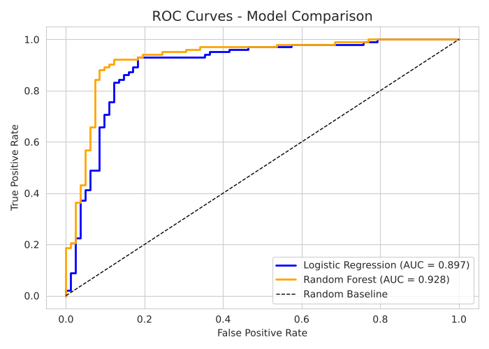
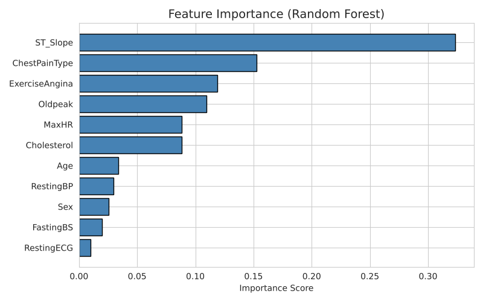
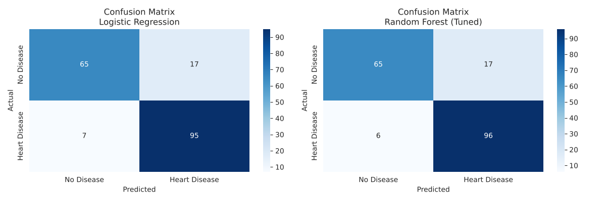

# Heart Disease Prediction with Machine Learning

A machine learning project that predicts whether a patient has heart disease from 11 medical features, using the public [Heart Failure Prediction dataset](https://www.kaggle.com/datasets/fedesoriano/heart-failure-prediction) (918 patients). Two models are trained and compared: **Logistic Regression** and a **tuned Random Forest**.

Course project for *Introduction to Machine Learning*, Umm Al-Qura University (2025–2026).

## Results

Test set: 184 patients (20% stratified split, `random_state=42`).

| Model | Accuracy | F1-score | ROC-AUC | Missed patients (false negatives) |
|---|---|---|---|---|
| Logistic Regression | 0.870 | 0.888 | 0.897 | 7 of 102 |
| Random Forest (tuned) | **0.875** | **0.893** | **0.928** | **6 of 102** |

- The tuned Random Forest is slightly better on every metric. The accuracy gap is small (161 vs 160 correct out of 184); the clearer gain is in ROC-AUC.
- Best Random Forest settings from GridSearchCV (5-fold CV): `n_estimators=50`, `max_depth=5`, `min_samples_split=5`. Best CV accuracy: 0.860.
- Top 5 features: `ST_Slope`, `ChestPainType`, `ExerciseAngina`, `Oldpeak`, `MaxHR`.

<p>
  
  
</p>



## What the notebook does

1. **Explore the data:** class balance (508 with disease, 410 without), age, sex, chest pain type, correlations, box plots.
2. **Preprocess:** check missing values (none), label-encode 5 categorical columns, 80/20 stratified split, `StandardScaler` fitted on the training set only.
3. **Train:** Logistic Regression (baseline) and Random Forest.
4. **Tune:** GridSearchCV over 18 Random Forest settings with 5-fold cross-validation.
5. **Evaluate:** accuracy, F1, ROC-AUC, confusion matrix, ROC curve.
6. **Explain:** Random Forest feature importance.

## Dataset

[Heart Failure Prediction Dataset](https://www.kaggle.com/datasets/fedesoriano/heart-failure-prediction) by fedesoriano on Kaggle. A copy is in `data/heart.csv`; see the Kaggle page for the license. The data is public and anonymized (no names or IDs).

| Feature | Description |
|---|---|
| Age | Age in years |
| Sex | M / F |
| ChestPainType | TA, ATA, NAP, ASY |
| RestingBP | Resting blood pressure (mm Hg) |
| Cholesterol | Serum cholesterol (mg/dL) |
| FastingBS | 1 if fasting blood sugar > 120 mg/dL, else 0 |
| RestingECG | Normal, ST, LVH |
| MaxHR | Maximum heart rate achieved |
| ExerciseAngina | Exercise-induced angina (Y/N) |
| Oldpeak | ST depression induced by exercise |
| ST_Slope | Up, Flat, Down |
| **HeartDisease** | **Target: 1 = heart disease, 0 = normal** |

## Limitations

- Small dataset (918 patients) and a single train/test split, so the small gap between the models may not hold on other splits.
- 172 patients have `Cholesterol = 0`, which is almost certainly missing data. These rows were kept as they are.
- Label encoding gives categories a fake order (for example ASY=0, ATA=1, NAP=2). This matters for Logistic Regression; one-hot encoding would be better.
- This is a learning project, not a medical tool.

## How to run

```bash
git clone https://github.com/Osama-F-Alharbi/heart-disease-prediction.git
cd heart-disease-prediction
pip install -r requirements.txt
jupyter notebook notebooks/heart_disease_prediction.ipynb
```

Or open the notebook in Google Colab and upload `data/heart.csv` when asked. Results above were reproduced with Python 3.13 and scikit-learn 1.9.1.

## Project structure

```
heart-disease-prediction/
├── data/heart.csv                           # dataset (from Kaggle)
├── notebooks/heart_disease_prediction.ipynb # full analysis, with outputs
├── images/                                  # plots saved by the notebook
├── requirements.txt
└── README.md
```

## Team and my role

This was a team project of four students. I led **data preprocessing and exploratory data analysis (EDA)** and also contributed to model tuning and evaluation.

## Use of AI

The code and text in this project were written with the help of AI tools. I reviewed the work, re-ran the notebook to confirm every number in this README, and I can explain every step of the analysis.
